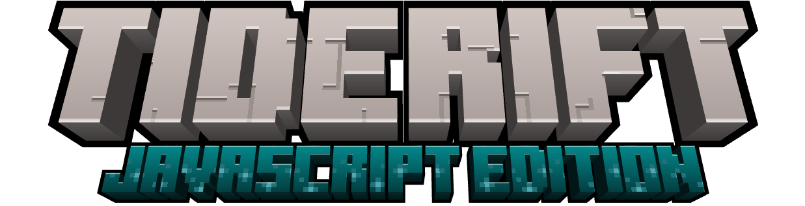

<div align="center">
  
</div>

<div align="center">

[](https://github.com/illagerCPR/Tiderift/actions/workflows/ci.yml)
[](https://github.com/illagerCPR/Tiderift/actions/workflows/docker.yml)
[](https://github.com/illagerCPR/Tiderift/actions/workflows/deploy-pages.yml)

[](https://github.com/illagerCPR/Tiderift/releases)
[](LICENSE)
[](https://nodejs.org/)
[](https://threejs.org/)
[](https://vitejs.dev/)

</div>

网页版 3D 沙盒游戏，基于 **Vite + Three.js** 的纯前端体素世界，支持**单机存档**与**局域网联机**。世界观见 [`docs/worldview.md`](docs/worldview.md)。

- 三种模式：**创造 / 生存 / 旁观**，本地多槽位存档
- **无限世界**：平原、山地、沙漠、雪原等群系，洞穴与岩浆湖，同种子世界完全一致
- **自然建筑**：村庄与村民（含交易）、要塞、战利品箱子，联机时各端一致
- **多维度**：主世界 / 下界 / 末地 / 天域，搭建传送门往返
- **建造与生存**：60+ 方块、85+ 物品、合成、背包与快捷栏、食物与饥饿、工具与盔甲、红石电路、命令面板
- **战斗**：怪物与 Boss（凋零）、弓、铁傀儡、信标、潜影盒
- **视听**：体素光照与昼夜、粒子效果、程序化音效与音乐、全景主菜单、水面与天气表现
- **界面**：11 种语言、设置面板、方块与物品图标、手持物与远端玩家 3D 模型
- **局域网联机**：房间服务器 + 同种子世界，实时同步方块、玩家、聊天与战斗（详见下文）
- **额外内容（可选模块）**：创建世界前可选开「工业」与「魔法」两条独立主线，默认关闭、创建后不可更改（详见下文）

---

## 快速开始

### 环境要求

- Node.js 18 或更高版本（开发与 CI 以 Node 26 验证）
- npm

### 安装依赖

```bash
npm install                    # 前端依赖（three / vite）
npm install --prefix server ws # 联机服务器依赖
```

### 启动开发服务器

```bash
# Windows (PowerShell)
.\start.cmd start      # 启动 → http://127.0.0.1:5173
.\start.cmd stop
.\start.cmd restart
.\start.cmd status

# Linux / macOS
./start.sh start       # 默认动作，可省略参数
./start.sh stop
./start.sh restart
./start.sh status
```

浏览器打开 `http://127.0.0.1:5173` 即可开始单机游戏。

### 生产构建

```bash
npm run build          # 产物输出到 dist/
npm run preview        # 预览构建产物
```

---

## 额外内容：魔幻现实（可选模块）

「额外内容」这一篇章统称 **魔幻现实**：潮退之后，人们一边把潮压进管道与传动轴，一边让潮在回响里重演——两条主线各自成立，同时开启才出现少量联动。

创建新世界前可以在「额外内容」界面里分别开启 **工业** 与 **魔法** 两个模块：默认全部关闭（就是原始体验），也可以只开一个，或两个都开。**世界创建后不可更改**——它不是随时可切的设置，而是这个世界的规则。

- **存档槽、导入摘要、联机房间信息**都会显示「工业 / 魔法」徽标；暂停菜单只显示、不能改。
- 联机时房间清单由**建房者**决定，加入者自动跟随；重复创建同名房间、加入已有房间都不会覆盖它。
- 关闭某个模块的世界里，该模块的方块与物品既不出现也合不出、放不下，服务器也会拒绝写入。
- 旧的存档与旧房间永远保持原始体验（缺字段按"全部关闭"读取）。

### 工业：潮工

利用燃料、热、水与机械传动，把零散营地变成能持续生产的工坊。

| 方块 | 作用 |
|---|---|
| **潮压锅炉** | 投入燃料（煤、木炭、木板…）与**桶装水**点火，产出潮压；空桶会被回收，取走后再添水即可继续烧 |
| **传动轴** | 六面相邻自动连成机械网络；网络的供给与需求决定所有机器的转速 |
| **碎石机** | 把圆石碎成砾石、砾石碎成沙；每 8 个成品额外掉 1 块燧石或粘土球 |
| **切割机** | 原木切出 6 块木板（手工只有 4）、骨头切出骨粉、石头切出石砖；比碎石机更费潮压 |
| **离合闸** | 装在轴中间当开关：**红石信号优先**（通电必断），无信号时按手动拨杆；断开等于把轴锯断 |

玩法：搭锅炉 → 用传动轴连到机器 → **右键机器打开界面**：点背包里的物品投入、点机器槽位取出；
界面上能看到原料/主产物/副产物、配方表、潮压供需与效率、加工进度，以及停不下来的原因（缺料、缺压、产物满…）。
潜行（Shift）+ 右键是快捷投料/取物，不用开界面。离合闸右键直接拨通断，接上拉杆就能用红石控制整条线。

缺压时整条轴一起变慢，拆掉锅炉全网停转；拆断一节轴只影响被切断的那一边。
副产物进独立槽位（不与主产物混栈），副产槽满了只丢掉那一次、不吞主产物。

### 魔法：四潮回响

裂潮之后留在星髓、潮火与雨水里的「回响」，可以用焦点短暂地重现。

| 物品 | 作用 |
|---|---|
| **回响仪台** | 右键消耗 **1 级经验**调谐出 25 点回响（回响是施法的费用，上限 100，脱战会极缓慢恢复） |
| **回响尘** | 用星髓研磨；仪台与两种焦点的材料 |
| **风潮焦点** | 右键 **风步**：沿视线短距冲刺（会被墙挡住，不会穿墙），随后短暂缓降 |
| **坠潮焦点** | 右键 **烬矢**：直线射出灼热弹，只伤生物，不点燃地形、不炸方块 |

屏幕下方快捷栏左侧会显示回响条；回响不足、法术冷却中、焦点不对时都会有提示。
创造与旁观模式不能施法。当前版本提供风潮与坠潮两系，雨潮与无潮在后续版本。

---

## 局域网联机

> 服务端只做房间管理、方块账本仲裁、消息中继与时间权威；各客户端用相同种子本地模拟世界，只同步改动。已支持方块共建、玩家移动与互殴、死亡重生、昼夜、聊天、掉落物、怪物与红石同步、多房间与断线重连、观战、世界内换房、管理面板、白名单与 op 权限、自动备份与限速。
>
> 联机模式**不写本地存档**：世界由服务器落盘，玩家档案由服务器保存。

### 1. 启动房间服务器

```bash
# Windows (PowerShell)
.\start.cmd server       # → ws://0.0.0.0:3001/ws
.\start.cmd server-stop

# Linux / macOS
./start.sh server        # 缺依赖时自动在 server/ 下 npm install
./start.sh server-stop
```

> Windows 首次监听可能弹出防火墙授权，需放行 TCP 3001。

### 2. 开房 / 加入

1. 开房者打开 `http://<开房机IP>:5173`，主菜单 →「局域网联机」→ 填**昵称**与**房间名** → **创建房间**（决定该房间世界种子）。
2. 其它玩家在局域网内访问 `http://<开房机IP>:5173`，填昵称、服务器地址 `ws://<开房机IP>:3001/ws` 与**相同的房间名** → **加入房间**。
3. 进入同一世界后即可共建方块、互相可见，按 **T** 聊天。

> 房间名相同即同一世界，不同房间完全隔离。服务器把每个房间保存到 `server/world/`，重启后进同名房间自动恢复；换世界只需换房间名。
>
> 游戏内命令：`/rooms` 列出房间、`/seed` 查看种子、`/room <名>` 换房（保持连接）、`/rebuild`（房主）重建世界、`/msg` 私聊、`/team` 组队、`/help` 查看全部命令。
>
> 生存模式下挖矿会掉物理掉落物（5 分钟消失）；玩家死亡会把背包散落原地（3 秒归属期内仅本人可拾取）；死亡后可点「观战其他玩家」旁观（F5 切换目标，R 重生）。

### 3. 服务器管理面板

开房机浏览器打开 `http://127.0.0.1:3001/`（其它电脑用 `http://<服务器IP>:3001/`）：

- **状态总览**：运行时长、房间列表、在线玩家、方块改动数、掉落物数与限速丢包统计。
- **配置管理**：掉落物过期时间、心跳间隔、每房间人数上限、限速、自动备份间隔与保留数、管理口令及有效期；修改即生效并写入 `server/config.json`。
- **世界管理**：清空掉落物、删除房间（重置世界）、下载房间备份。
- **房间设置**：按房间开关 PVP 与怪物生成，热生效。
- **权限**：房间白名单与 op 名单、多账号口令（轮换 / 撤销）。
- **操作日志**：最近 200 条管理操作。

---

## Docker 部署（推荐用于长期开服）

一个容器同时提供**游戏客户端**与**联机服务器**，玩家打开一个地址即可游玩，无需安装 Node。

```bash
docker run -d --name tiderift \
  -p 3001:3001 \
  -v tiderift-data:/data \
  --restart unless-stopped \
  ghcr.io/illagercpr/tiderift-server:latest
```

启动后：

| 地址 | 用途 |
|---|---|
| `http://<主机IP>:3001/` | 游戏客户端（玩家打开即玩） |
| `http://<主机IP>:3001/admin` | 服务器管理面板 |

玩家进入主菜单 →「局域网联机」→ 填昵称与房间名 → 创建/加入房间即可。**服务器地址会自动填成当前页面所在主机**，无需手动输入 IP。

### 数据持久化

世界存档与服务器配置都保存在 `/data` 卷中：

```
/data/world/<房间名>.json     房间世界（方块账本、掉落物、种子、时间）
/data/world/players/          玩家档案
/data/config.json             服务器配置（管理面板修改后写入）
```

删除容器不会丢数据；`docker rm -v` 或删除卷才会。

### 环境变量

| 变量 | 默认值 | 说明 |
|---|---|---|
| `PORT` | `3001` | 监听端口 |
| `HOST` | `0.0.0.0` | 监听地址 |
| `TIDERIFT_DATA_DIR` | `/data` | 数据根目录（世界与配置都放这里） |
| `TIDERIFT_STATIC_DIR` | `/app/dist` | 客户端静态文件目录 |

### docker compose

仓库内提供 `docker-compose.yml`：

```bash
docker compose up -d      # 启动
docker compose logs -f    # 查看日志
docker compose down       # 停止（数据卷保留）
```

### 自行构建

```bash
docker build -t tiderift .
docker run -d -p 3001:3001 -v tiderift-data:/data tiderift
```

> 镜像由 GitHub Actions 在每次 push `master` 与发布 Release 时自动构建，支持 `linux/amd64` 与 `linux/arm64`。

---

## 操作说明

| 键位 | 功能 |
|---|---|
| WASD | 移动 |
| 空格 | 跳跃（创造模式下双击切换飞行） |
| Shift | 下蹲 / 潜行 |
| 鼠标左键 / 右键 | 破坏 / 放置方块（手持食物 = 食用；弓 = 按住蓄力；焦点 = 施法；机器 = 投料/取物） |
| 滚轮 / 1-9 | 切换快捷栏物品 |
| E | 打开背包（合成）；背包 / 容器打开时按 ESC 也可关闭 |
| Q / Ctrl+Q | 丢弃手中 1 个 / 整组物品 |
| J | JEI 配方面板开关（无容器界面时打开背包） |
| R | 悬停物品时查看配方 / 用途；**观战中重生退出观战** |
| C | 命令面板（仅"启用命令"的存档） |
| T | 联机聊天 |
| F5 | 手动保存（联机不保存）；**观战中切换观战目标** |
| ESC | 暂停菜单（有界面打开时先关闭该界面） |

---

## 已知限制（额外内容）

- **工业**：潮压只来自锅炉（水车、风车与流体管道尚未实现）；红石只控制离合闸通断，不控制转速。
  单个机械网络上限 128 个节点（超出整网停转），每房间工业账本上限 512 台；超限网络不会静默复制物品。
  机器界面按格子点投/取（不做拖拽），也不支持把整组物品一次分到多个槽。
- **魔法**：目前只有风潮「风步」与坠潮「烬矢」两系，雨潮「回潮」与无潮「折步」在后续版本；
  暂无蓄力区分基础/进阶。回响上限 100，脱战每 6 秒恢复 1 点（防卡死兜底，主动获取靠仪台调谐）。
- 关闭模块的世界里，如果导入的旧存档带着该模块的方块，方块会**保留但不再运行**（不会替换成空气，也不会继续生产）。
- 联机时服务器的权威范围是**启用状态、形状与频率**；回响与背包沿用项目既有的玩家档案模型（轻信任、不宣称反作弊）。

## 已知限制（联机）

- 怪物采用事件同步（房主生成、受击与死亡广播）：各端 AI 独立跑，位置可能有轻微漂移；非攻击致死（白天燃烧、掉虚空）可能各端各自产生掉落物。
- 红石各端独立收敛，高频红石（快速闪烁）可能有轻微 tick 漂移；方块冲突以最后写入为准。
- 背包不全量同步：只同步手持槽与生命/饥饿，拾取由拾取端本地入包；死亡掉落物由死亡端上报生成（3 秒归属锁内仅本人可拾取）。
- 世界落盘只含方块、掉落物与时间；地形由种子重建，玩家背包与位置存在服务器玩家档案中。
- 断线自动重连依赖服务器仍在运行；服务器重启后需按相同房间名重新加入。
- 观战为死亡后旁观，第一人称跟随（F5 切换目标，R 重生）；观战时其他玩家看不到观战者。
- 手持物为 3D 模型渲染，可能穿墙（与原版一致的简化处理）。
- 阿拉伯语暂为 LTR 布局（仅文本本地化，不做 RTL 镜像）。
- 管理面板默认无鉴权（局域网信任环境）；可设置管理口令或多账号口令，过期后仅能续期/关闭。

---

## 在线试玩

GitHub Pages 提供构建产物的单机版本：<https://www.illageraris.dpdns.org/Tiderift/>。联机仍需按上文在局域网自建服务器。

---

## 许可证

Copyright (C) 2026 illagerCPR and Tiderift contributors

本项目以 [GNU Affero General Public License v3.0](LICENSE) 发布。通过网络使用本项目的修改版本时，须按 AGPL-3.0 第 13 条向用户提供对应源码。

默认皮肤、logo 与主菜单全景图均为本项目原创，未包含 Mojang 素材。第三方组件（three.js / Vite / ws）的许可见 [THIRD-PARTY-NOTICES.md](THIRD-PARTY-NOTICES.md)。

---

开发者参考资料：[`docs/development.md`](docs/development.md)（环境与依赖、命令、目录结构、架构概览、回归测试与 CI）。
